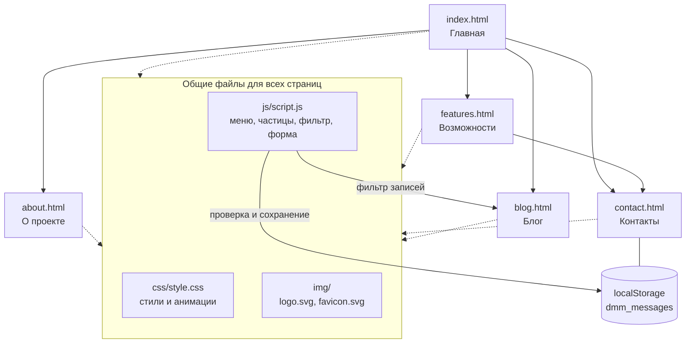

# Deadlock Mod Manager — сайт проекта

Лендинг для менеджера модов к игре **Deadlock**. Сам менеджер ещё в разработке, сайт рассказывает о проекте и собирает обратную связь до релиза.

> Неофициальный проект сообщества. Не связан с Valve. Deadlock — торговая марка Valve Corporation.

## О сайте

Статический сайт из 5 страниц без сборщиков и фреймворков. Главное в нём — визуал в духе Deadlock: тёмный сине-зелёный фон, золотые и янтарные акценты, заголовки в стиле арт-деко.

| Страница | Файл | Что на ней |
|---|---|---|
| Главная | `index.html` | Заголовок, макет окна менеджера, три причины попробовать |
| Возможности | `features.html` | Список функций и статус разработки |
| О проекте | `about.html` | Зачем нужен менеджер, принципы, дисклеймер |
| Блог | `blog.html` | Новости и заметки с фильтром по темам |
| Контакты | `contact.html` | Форма обратной связи и контакты |

## Карта сайта



Сплошные стрелки показывают переходы по кнопкам и ссылкам, пунктирные — подключение общих файлов. Верхнее меню на каждой странице ведёт на все пять страниц.

## Технологии

- HTML5 с семантической разметкой
- CSS3: переменные, grid и flexbox, адаптивная вёрстка, анимации
- JavaScript без библиотек, `localStorage` для сообщений формы
- Git для контроля версий, GitHub Pages для хостинга
- Visual Studio Code для разработки

## Что реализовано

- Анимации: плавающие «угольки» на canvas, последовательное появление текста на главной, демо-переключатели модов, пульсация бейджа и текущего этапа, hover-эффекты
- Форма обратной связи с проверкой имени, email и сообщения, сообщения сохраняются в `localStorage` под ключом `dmm_messages`
- Фильтр записей блога по темам
- Мобильное меню и адаптивная вёрстка
- Видимый фокус с клавиатуры, учёт `prefers-reduced-motion`

## Структура проекта

```
deadlock-mod-manager/
├── index.html
├── features.html
├── about.html
├── blog.html
├── contact.html
├── css/
│   └── style.css
├── js/
│   └── script.js
├── img/
│   ├── logo.svg
│   ├── favicon.svg
│   └── screenshots/
├── pages/
└── README.md
```

## Дизайн

Цвета заданы переменными в начале `css/style.css`:

| Назначение | Цвет |
|---|---|
| Фон | `#0a0e0f` |
| Панели | `#121819` |
| Линии | `#2b3431` |
| Золото (основной акцент) | `#e2b45f` |
| Янтарь | `#c47f2a` |
| Бирюза | `#3f8f86` |
| Текст | `#ece5d3` |

Шрифты: **Cinzel** для заголовков и **Hanken Grotesk** для текста, подключаются через Google Fonts. Если они недоступны, используются системные шрифты.

## Запуск локально

1. Откройте папку проекта в VS Code.
2. Установите расширение **Live Server** и нажмите «Go Live», либо просто откройте `index.html` в браузере.

Затем в репозитории откройте **Settings → Pages**, выберите источник **Deploy from a branch**, ветку `main` и папку `/ (root)`. Сайт появится по адресу `https://<ваш-ник>.github.io/<репозиторий>/`.

## Форма обратной связи

У сайта нет сервера, поэтому форма только сохраняет сообщения в браузере. Посмотреть их можно в консоли разработчика командой `JSON.parse(localStorage.getItem("dmm_messages"))`. Чтобы получать сообщения на почту, подключите сервис вроде Formspree и укажите его адрес в атрибуте `action` формы.


## Статус проекта

Менеджер модов в разработке, релиз пока не назначен. Актуальный статус этапов: страница «Возможности».